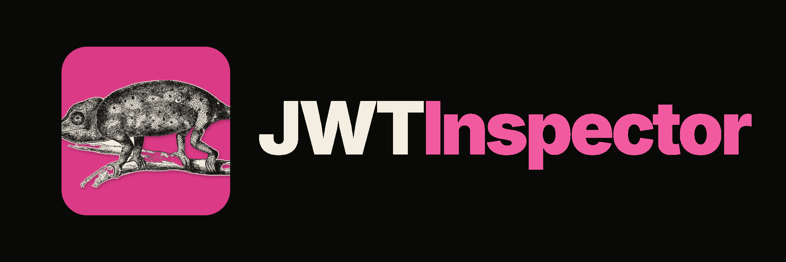
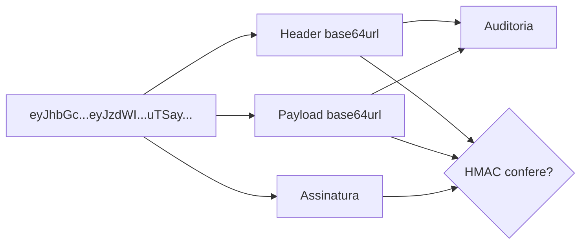

<p align="center"><sub>JWT Inspector</sub></p>

---

<p align="center">
  
</p>

<p align="center">
  Decodifica tokens JWT, verifica assinatura HMAC e audita a configuração
</p>

<p align="center">
  
  
  <a href="https://github.com/arthurlynow098/jwt-inspector/actions/workflows/testes.yml"></a>
  
</p>

## Sobre o projeto

Quase toda API que fiz no curso e no trabalho usa JWT para autenticação, e por muito tempo eu tratei aquele texto gigante começando com `eyJ` como uma caixa preta. Um dia descobri que o conteúdo dele **não é criptografado**, só codificado em base64. Qualquer pessoa que pegar o token consegue ler tudo o que está dentro.

O JWT Inspector abre o token, mostra o header e o payload com as datas em formato legível e audita a configuração. Ele aponta token sem prazo de validade, validade longa demais, CPF ou senha dentro do payload, algoritmo `none` e cabeçalhos que pedem para o servidor buscar a chave em outro lugar. Também confere a assinatura HMAC quando você informa o segredo.

## Como funciona



## Tecnologias

<p>
  
  
  
</p>

## Executando o código

Só precisa de Python 3.10 ou mais novo.

```bash
git clone https://github.com/arthurlynow098/jwt-inspector.git
cd jwt-inspector

python -m jwtinspector eyJhbGciOiJIUzI1NiIsInR5cCI6IkpXVCJ9.eyJzdWIiOiI0MiIs...

# confere a assinatura (o segredo é digitado escondido)
python -m jwtinspector <token> --verificar --algs HS256

# também lê da entrada padrão
cat token.txt | python -m jwtinspector
```

Use com tokens das suas próprias aplicações. Token de produção é credencial, não cole em site de terceiros para decodificar.

Testes

```bash
pip install -r requirements-dev.txt
python -m pytest -q
```

## Exemplo

Um token de exemplo que eu gerei com o próprio projeto, com CPF fictício e validade de 30 dias.

```text
  PAYLOAD
  {
    "sub": "42",
    "nome": "Arthur",
    "cpf": "000.000.000-00",
    "role": "user",
    "iat": 1794700000,
    "exp": 1797292000
  }
  iat = 14/11/2026 20:46:40
  exp = 14/12/2026 20:46:40

  AUDITORIA (5 item(ns))
  [!! ] dado sensível no payload
        campos cpf ficam legíveis para qualquer um com o token
  [!  ] validade longa
        720 h de vida, para access token o comum é minutos ou poucas horas
  [!  ] sem iss
  [!  ] sem aud
  [ i ] assinatura simétrica HS256
        quem verifica também consegue assinar, o segredo precisa ter 256 bits aleatórios e ficar só no servidor
```

## Estudei por aqui

Segui essas aulas e materiais para entender e aplicar tudo que está aqui.

| Material | O que tirei dele |
|---|---|
| [TryHackMe, JWT Security](https://tryhackme.com/room/jwtsecurity) | Erros comuns de configuração e como se proteger |
| [PortSwigger Academy, JWT](https://portswigger.net/web-security/jwt) | Como o servidor deve validar algoritmo, chave e claims |
| [Introdução ao JWT no jwt.io](https://jwt.io/introduction) | Estrutura do token e claims padrão |
| [RFC 7519](https://www.rfc-editor.org/rfc/rfc7519) | A especificação oficial |
| [OWASP REST Security Cheat Sheet](https://cheatsheetseries.owasp.org/cheatsheets/REST_Security_Cheat_Sheet.html) | Boas práticas de autenticação em API |

## Licença

Distribuído sob a licença MIT. Veja o arquivo [LICENSE](LICENSE).

<p align="center"><sub>A gravura do banner é o camaleão do livro Introduction to Zoology, de 1900, em domínio público no <a href="https://commons.wikimedia.org/wiki/File%3AImage_from_page_291_of_%22Introduction_to_zoology%3B_a_guide_to_the_study_of_animals%2C_for_the_use_of_secondary_schools%3B%22_%281900%29_%2814598580847%29.jpg">Wikimedia Commons</a>.</sub></p>
