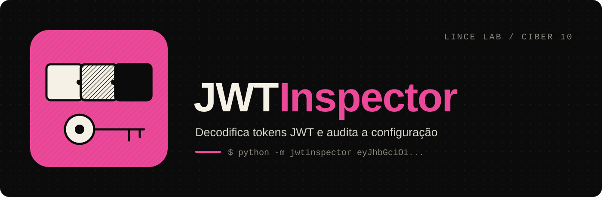
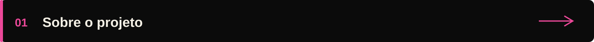
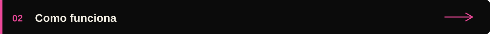
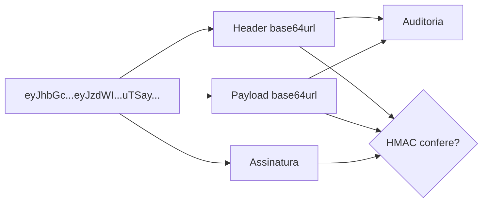
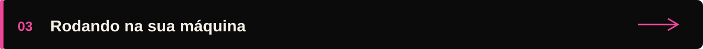
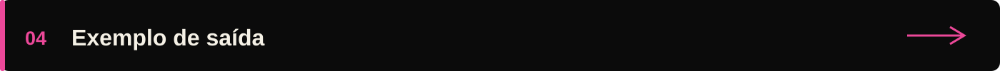
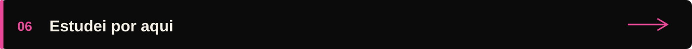

<a id="top"></a>

<p align="center"></p>

<p align="center">


<a href="https://github.com/arthurlynow098/jwt-inspector/actions/workflows/testes.yml"></a>

</p>

<p align="center"><a href="#sobre">Sobre</a> &nbsp;&nbsp; <a href="#como-funciona">Como funciona</a> &nbsp;&nbsp; <a href="#rodando">Rodando</a> &nbsp;&nbsp; <a href="#aprendi">O que aprendi</a> &nbsp;&nbsp; <a href="#estudos">Estudos</a></p>

<a id="sobre"></a>

<p></p>

Quase toda API que fiz no curso e no trabalho usa JWT para autenticação, e por muito tempo eu tratei aquele texto gigante começando com `eyJ` como uma caixa preta. Um dia descobri que o conteúdo dele **não é criptografado**, só codificado em base64. Qualquer pessoa que pegar o token consegue ler tudo o que está dentro.

O JWT Inspector abre o token, mostra o header e o payload com as datas em formato legível e audita a configuração. Ele aponta token sem prazo de validade, validade longa demais, CPF ou senha dentro do payload, algoritmo `none` e cabeçalhos que pedem para o servidor buscar a chave em outro lugar. Também confere a assinatura HMAC quando você informa o segredo.

<a id="como-funciona"></a>

<p></p>



| Verificação | Severidade | Por que |
|---|---|---|
| `alg` igual a `none` | crítica | Token sem assinatura nenhuma, nunca deveria ser aceito |
| `jku`, `x5u` ou `jwk` no header | alta | O token tentando dizer ao servidor qual chave usar. Quem decide isso é o servidor |
| Sem `exp` | alta | Se vazar, vale para sempre |
| Dado sensível no payload | alta | CPF, senha, cartão. Fica legível para qualquer um |
| Validade acima de 24h | média | Access token costuma durar minutos, o refresh token é que dura mais |
| Sem `iss` ou `aud` | média | O servidor não consegue conferir quem emitiu e para quem |
| `kid` com `/`, `..` ou aspas | média | O servidor precisa tratar esse campo como dado e validar |
| `iat` no futuro | média | Relógio errado ou token forjado |

Na verificação de assinatura tem um detalhe que considero o mais importante do projeto. **A lista de algoritmos aceitos é decidida pelo servidor, nunca pelo campo `alg` do próprio token.** Os testes cobrem isso, um token assinado com HS512 é recusado quando o servidor só aceita HS256.

<a id="rodando"></a>

<p></p>

Só precisa de Python 3.10 ou mais novo.

```bash
git clone https://github.com/arthurlynow098/jwt-inspector.git
cd jwt-inspector

python -m jwtinspector eyJhbGciOiJIUzI1NiIsInR5cCI6IkpXVCJ9.eyJzdWIiOiI0MiIs...

# confere a assinatura (o segredo é digitado escondido)
python -m jwtinspector <token> --verificar --algs HS256

# também lê da entrada padrão
cat token.txt | python -m jwtinspector
```

Use com tokens das suas próprias aplicações. Token de produção é credencial, não cole em site de terceiros para decodificar.

Testes

```bash
pip install -r requirements-dev.txt
python -m pytest -q
```

<p></p>

Um token de exemplo que eu gerei com o próprio projeto, com CPF fictício e validade de 30 dias.

```text
  PAYLOAD
  {
    "sub": "42",
    "nome": "Arthur",
    "cpf": "000.000.000-00",
    "role": "user",
    "iat": 1794700000,
    "exp": 1797292000
  }
  iat = 14/11/2026 20:46:40
  exp = 14/12/2026 20:46:40

  AUDITORIA (5 item(ns))
  [!! ] dado sensível no payload
        campos cpf ficam legíveis para qualquer um com o token
  [!  ] validade longa
        720 h de vida, para access token o comum é minutos ou poucas horas
  [!  ] sem iss
  [!  ] sem aud
  [ i ] assinatura simétrica HS256
        quem verifica também consegue assinar, o segredo precisa ter 256 bits aleatórios e ficar só no servidor
```

<a id="aprendi"></a>

<p></p>

- A estrutura de um JWT e a diferença entre codificar e criptografar
- Como o HMAC garante que ninguém alterou o payload, e o teste que prova isso
- Diferença entre assinatura simétrica (HS256) e assimétrica (RS256, ES256) e quando usar cada uma
- Por que o servidor precisa fixar o algoritmo esperado
- Claims padrão (`exp`, `iat`, `nbf`, `iss`, `aud`, `sub`) e o papel de cada uma

Próximos passos

- [ ] Verificar RS256 e ES256 usando a biblioteca `cryptography`
- [ ] Ler a chave pública de um endpoint JWKS confiável configurado pelo usuário
- [ ] Comparar com o que a PyJWT valida por padrão

<a id="estudos"></a>

<p></p>

Segui essas aulas e materiais para entender e aplicar tudo que está aqui.

| Material | O que tirei dele |
|---|---|
| [TryHackMe, JWT Security](https://tryhackme.com/room/jwtsecurity) | Erros comuns de configuração e como se proteger |
| [PortSwigger Academy, JWT](https://portswigger.net/web-security/jwt) | Como o servidor deve validar algoritmo, chave e claims |
| [Introdução ao JWT no jwt.io](https://jwt.io/introduction) | Estrutura do token e claims padrão |
| [RFC 7519](https://www.rfc-editor.org/rfc/rfc7519) | A especificação oficial |
| [OWASP REST Security Cheat Sheet](https://cheatsheetseries.owasp.org/cheatsheets/REST_Security_Cheat_Sheet.html) | Boas práticas de autenticação em API |

<p align="center"><sub>Parte do <a href="https://github.com/arthurlynow098">Lince Lab</a>, minha coleção de projetos de cibersegurança</sub></p>

<p align="center"><a href="#top">Voltar ao topo</a></p>
